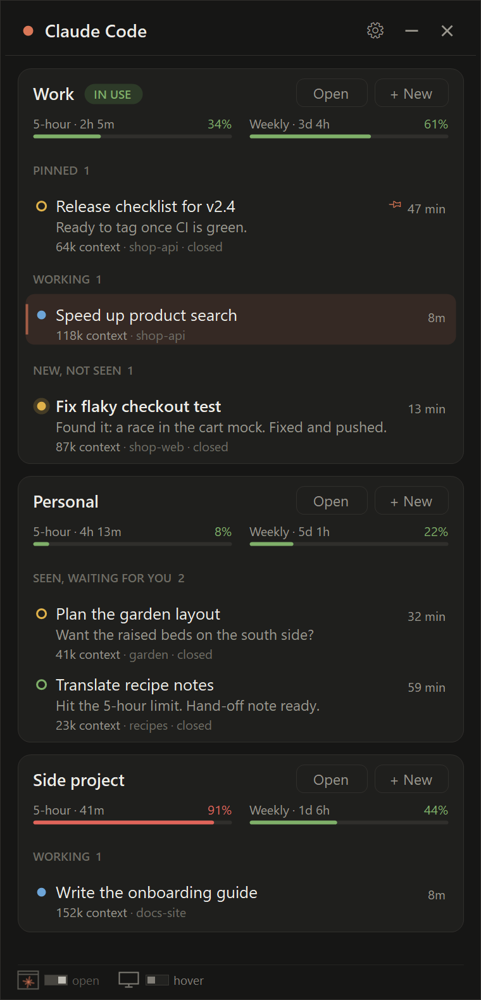
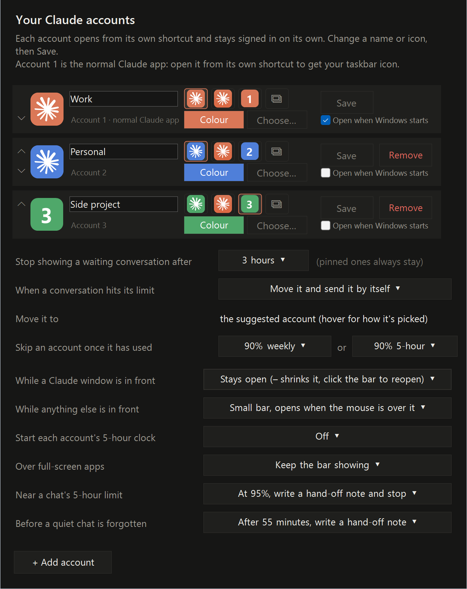
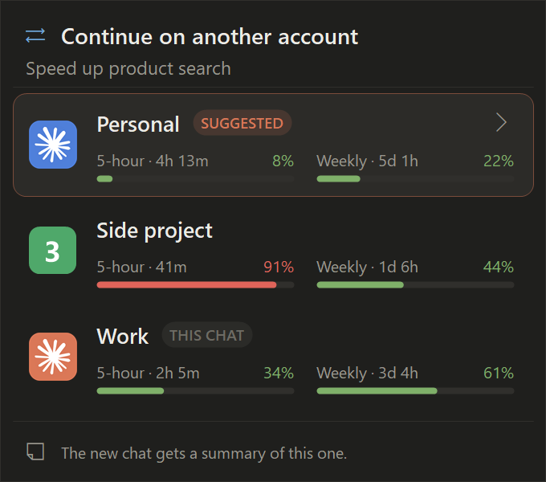

# Claude Desktop: log into multiple accounts at once

**See every account's usage and active conversations in one small taskbar widget.**

Bonus: track each conversation's context, pin conversations, open any conversation in one click, start new ones on any account, hand a conversation to another account automatically when it hits its limit, and give each account its own icon.

For Windows. Nothing to download but this source: it builds on your PC with the compiler that ships with Windows.

  
  &nbsp;&nbsp;
  

  
  &nbsp;&nbsp;
  

Sample accounts and conversations. Above: the panel and the settings window. Below: the hand-off card and the bar that sits on the taskbar.

## What it does

### Several accounts, signed in at the same time
- **One shortcut per account.** Each opens its own Claude window and stays signed in on its own; the accounts never merge or sign each other out.
- **Its own taskbar button and icon.** Pick the Claude icon in any colour, the normal Claude icon, a number, or your own picture, so you can tell the windows apart at a glance.
- **Add an account any time.** It opens straight on Claude's sign-in screen. Rename, recolour, reorder or remove accounts later.
- **Open when Windows starts**, ticked per account.

### The taskbar widget (Claude Tracker)
A small always-on-top panel, opened from its icon by the clock. The icon shows how much of your 5-hour limit you've used.

- **A bar on the taskbar** shows your 5-hour use and how many conversations are new or busy. Drag it left or right to any free spot on the taskbar.
- **The panel opens above the bar.** Choose separately for when a Claude window is in front and for everything else: it **stays open**, or it **opens when the mouse rests on the bar** and fades away when the mouse leaves. Switch with the two small toggles at the bottom of the panel.
- **Switching windows is instant:** the panel appears or disappears the moment you go to or from Claude. When Claude is minimised or brought back, it fades along with it.
- **The conversation open in each account's window is highlighted**, a little stronger for the window in front.

- **Usage per account:** 5-hour and weekly limits with how long until each resets.
- **Active Claude Code conversations per account**, grouped:
  - **Working:** Claude is replying right now.
  - **New, not seen:** finished while you were away.
  - **Seen, waiting for you.**
  - A chat that hit a limit sits with the others, marked "hit a limit".
- **Context used** by each conversation (for example "132k context").
- **One click** opens a conversation in the right account's window.
- **Open** brings up that account's Claude window, starting it if it's closed. **+ New** starts a new Claude Code chat on that account.
- **Pin** a conversation to keep it at the top; **finish** it to clear it away (finishing unpins it).
- **Hand off** any conversation to another account. A card lists every account with both limits and when they reset, marks the **suggested** one, greys out accounts that are too full, and puts the chat's own account last. Pick one (click, or arrow keys and Enter) and a new chat opens there with the conversation's hand-off note or a summary already typed in.

### Hand-off notes
So nothing decided earlier gets lost when a chat moves:
- **Near the 5-hour limit** (for example at 95%), Claude finishes the step it is on, writes a short note (the goal, what was decided and why, what is done, the next step) and stops. The last few percent are kept so there is room to write it.
- **Before a quiet chat is forgotten:** Claude remembers a chat cheaply for an hour after its last message. A bigger chat left alone for 55 minutes is asked to write its note while that is still cheap.
- The new chat gets the note when the chat moves.

### Automatic hand-off at the limit
When a conversation hits its usage limit, the tracker can move it to the suggested account (the same one the hand-off card marks). Choose to:
- do nothing,
- get a notification you click to move it,
- move it and press Enter yourself, or
- **move and send it by itself.** It brings the new chat to the front, holds your mouse and keyboard still for a moment so the key can't land anywhere else, and presses Enter. It then checks that the new chat really started and presses Enter again if it didn't (a few times, waiting longer each time). If the window isn't in front, or it still didn't start, it tells you to press Enter yourself.

**How the account is suggested:** one with room left in its 5 hours (counting chats already running there) whose weekly limit is most likely to go unused before it resets. Close calls go to the one whose 5-hour limit resets sooner. You choose **when an account is too full to take it**, for example once it has used 90% of its weekly or 5-hour limit.

### Starting each account's 5-hour clock
Optional. When an account's 5-hour limit isn't counting down, the tracker sends it a one-line message in a new chat so the 5 hours start now, either only while you're away from the PC or any time. Accounts past the weekly "too full" setting are skipped. These chats don't show in the panel.

## Install

1. Install the Claude desktop app from <https://claude.ai/download>.
2. Download the zip from the [latest release](https://github.com/citrunade/claude-desktop-multi-account/releases/latest) and unzip it.
3. Double-click **install.cmd**. Say how many accounts you want, and whether you want the widget.
4. Open each new shortcut once and sign in to a different account.

To keep an account on the taskbar, open it, right-click its taskbar button and choose **Pin to taskbar**.

Windows may warn that the file came from the internet: choose **More info → Run anyway**. Nothing is precompiled. Everything is plain source (`install.ps1`, `src/`), built on your PC by the .NET compiler that ships with Windows.

## Settings

Use the **gear button** on the widget, or **Start menu → Claude Accounts → Manage Claude accounts**:

- add, rename, recolour or remove accounts (removing closes the account first, and you choose whether to keep its sign-in)
- the order accounts show in, and which ones open when Windows starts
- how long a waiting conversation stays in the widget (30 minutes to 1 week; pinned ones always stay)
- what happens when a conversation hits its limit, and when an account is too full to take it
- whether the panel stays open or opens on hover, separately for when a Claude window is in front and for everything else
- starting each account's 5-hour clock
- whether the bar stays or hides over full-screen apps
- hand-off notes near the 5-hour limit and before a quiet chat is forgotten

## How it works

- Every account gets a small launcher in `%USERPROFILE%\Apps\Claude Account N` that gives its windows their own taskbar button and icon.
- **Account 1** is the normal Claude app and its usual sign-in.
- **Accounts 2 and up** start Claude with their own data folder (`%APPDATA%\Claude-N`), which is why the sign-ins stay separate.
- **Claude Tracker** lives in `%USERPROFILE%\Apps\Claude Tracker` and starts with Windows.
  - It reads Claude's own files on your PC. Nothing is sent anywhere.
  - Usage readings come from a tiny local Claude Code plugin it registers (`plugins/limits-beacon`). The plugin makes no model calls and uses no tokens.

## Uninstall

Double-click **uninstall.cmd**. Your sign-ins are kept. To remove them too, run `uninstall.cmd -RemoveSignIns`.

## License

MIT
